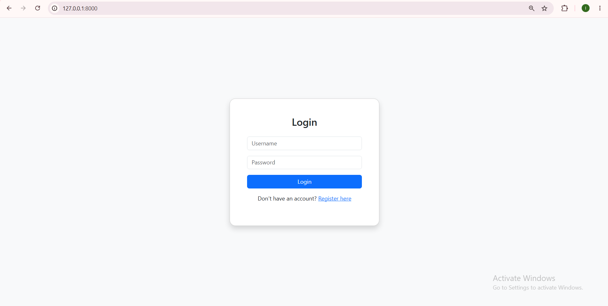
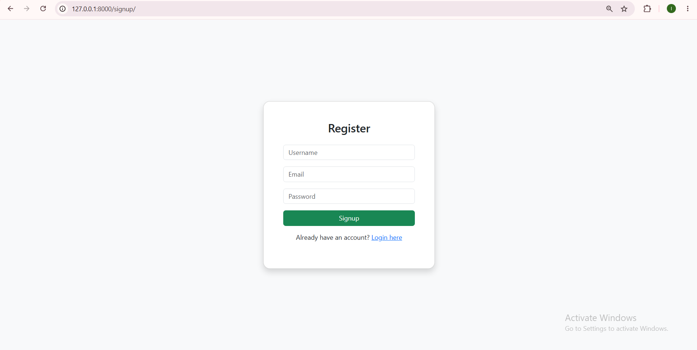
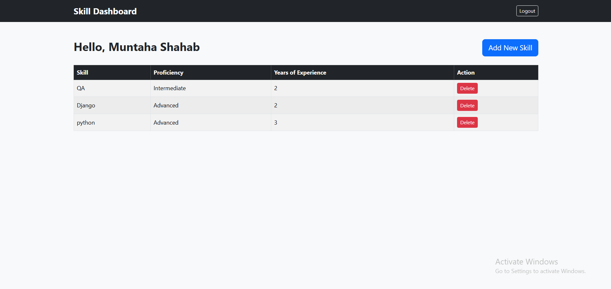

# Django Skill Management System

A simple web application built with Django to manage personal skills and keep track of proficiency levels and years of experience. Users can create an account, log in, and manage their skills through a dashboard.

## Screenshots

### Login Page


### Signup Page


### Dashboard


## Features

- User registration and login
- User-specific dashboard
- Add skills with proficiency levels and years of experience
- View saved skills
- Delete skills from the dashboard
- Authentication required to access the dashboard and manage skills
- SQLite database for storing application data

## Technologies Used

- **Python**
- **Django**
- **SQLite**
- **HTML and CSS**
- **python-dotenv** for environment variable management

## Project Structure

```text
django-skill-management-system/
├── docs/
│   └── screenshots/
│       ├── login.png
│       ├── signup.png
│       └── dashboard.png
├── skillproject/
│   ├── skills/
│   │   ├── migrations/
│   │   ├── templates/
│   │   ├── models.py
│   │   ├── tests.py
│   │   ├── urls.py
│   │   └── views.py
│   ├── skillproject/
│   │   ├── settings.py
│   │   └── urls.py
│   ├── manage.py
│   └── requirements.txt
├── .gitignore
└── README.md
```

## Getting Started

### 1. Clone the repository

```bash
git clone https://github.com/Muntaha-Shahab/django-skill-management-system.git
cd django-skill-management-system
```

### 2. Create a virtual environment

On Windows:

```powershell
python -m venv .venv
.\.venv\Scripts\Activate.ps1
```

### 3. Install dependencies

```bash
pip install -r .\skillproject\requirements.txt
```

### 4. Configure environment variables

Create a `.env` file inside the `skillproject` folder, alongside `manage.py`.

Add the following variables:

```env
SECRET_KEY=your-django-secret-key
DEBUG=True
ALLOWED_HOSTS=127.0.0.1,localhost
```

Replace `your-django-secret-key` with a private Django secret key. Keep the `.env` file out of version control.

### 5. Apply migrations

```powershell
python .\skillproject\manage.py migrate
```

### 6. Start the development server

```powershell
python .\skillproject\manage.py runserver
```

Open [http://127.0.0.1:8000/](http://127.0.0.1:8000/) in your browser.

## Running Tests

Run the application tests with:

```powershell
python .\skillproject\manage.py test skills
```

Check the Django configuration with:

```powershell
python .\skillproject\manage.py check
```

## Notes

- Each user manages their own skills through an authenticated account.
- The project uses SQLite for local development.
- The `.env` file and local database are excluded from Git.
- This project is intended for learning and demonstrating Django fundamentals.

## Future Improvements

- Edit existing skills
- Search and filter skills
- Add skill categories
- Improve dashboard design and responsiveness

## Author

**Muntaha Shahab**

GitHub: [Muntaha-Shahab](https://github.com/Muntaha-Shahab)
